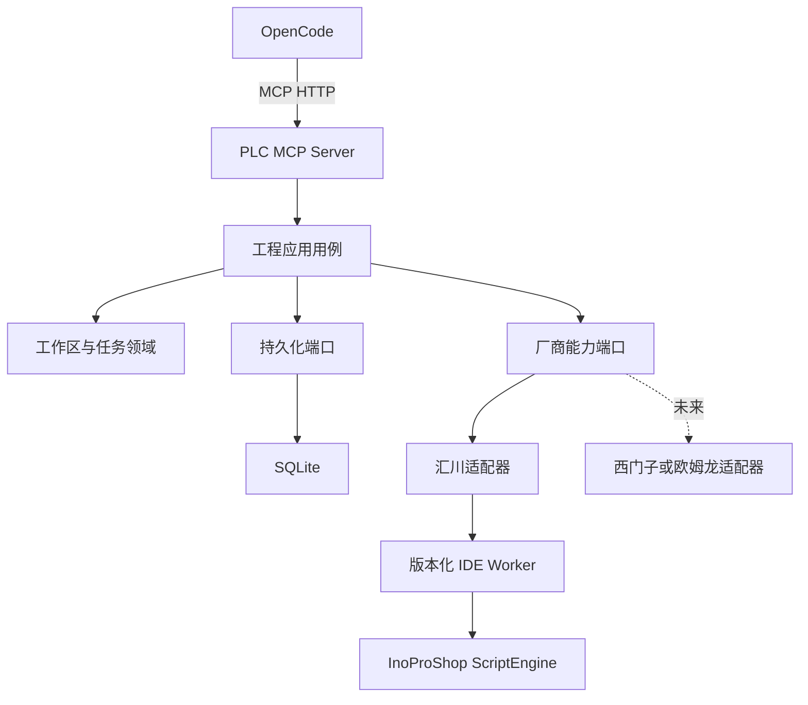
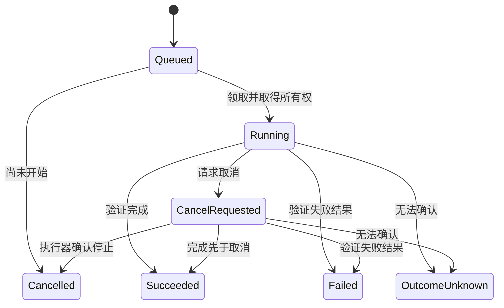

# 架构设计

## 总体设计

采用 DDD + Clean Architecture + Ports & Adapters 的模块化单体。Host、应用用例与平台元数据处于一个部署单元；IDE Worker 按运行时、版本和 Windows 会话进行进程隔离。

## 产品与协议边界

本项目交付 PLC 工程自动化 MCP Server。`McpHost` 是 ASP.NET Core 可执行项目名称；按 MCP 协议角色，它是 Server，OpenCode 是承载 Client 的 AI 应用。仓库名称中的 Platform 不代表通用 MCP 服务管理平台。

| 连接边界 | 调用方式 | 职责 |
|---|---|---|
| OpenCode 与本服务 | MCP / Streamable HTTP | 工具发现、输入输出、执行结果 |
| Tool、应用用例、厂商适配器之间 | 进程内 C# 端口调用 | PLC 工程规则、编排、厂商语义转换 |
| 厂商适配器与 IDE Worker | 版本化内部 JSON 请求/结果文件 | 隔离 IDE 运行时与执行会话；不是 MCP 上游服务 |
| IDE 脚本与工程对象 | 官方 ScriptEngine API | 工程读取、编辑、保存、编译与诊断 |

汇川适配器不是独立 MCP Server，脚本本身也不是 MCP 服务。增加西门子或欧姆龙时，优先增加内部适配器及必要的 Worker，不为每个厂商重复实现 MCP 协议。进程隔离不要求引入第二层 MCP。

本项目不开发任意第三方 MCP 服务的注册/托管/聚合、通用代理路由、组织级服务目录或 LLM 网关。[Obot 官方架构](https://docs.obot.ai/concepts/architecture/)将 MCP/LLM 网关、托管、身份访问、审计和注册目录作为平台能力。未来若出现这些需求，可由既有产品管理本服务，无需在本项目复刻网关。

基本鉴权、日志、超时等机制可能与网关重叠，但服务仍负责 PLC 业务约束：工程访问范围、修订冲突、IDE 串行、备份、部分执行结果与恢复。网关的工具访问控制不能替代这些工程规则。DDD 用于表达这些规则，不用于构建通用 MCP 平台。

例如 `plc_pou_update` 的目标路径是：MCP Tool 将输入转换为应用请求，应用层核验工作区并提交工程任务，汇川适配器调用受控脚本，最终返回读回与保存结果，编译由单独工具提交。此处没有向“汇川 MCP”转发 `tools/call`。P2 已实现副本写入、保存重开、版本发布和证据对账；独立测试宿主验证调用流程。当前共实现 74 个工具；未提供真实验收记录时，正式宿主开放 22 个不依赖 IDE 的本地工具，其余工程工具按实际版本和验收范围开放。

角色定义参考 [MCP 官方架构](https://modelcontextprotocol.io/docs/learn/architecture)；外部产品资料核对日期：2026-11-06。

## 目标执行结构

图表示执行结构。P1 已落地任务存储、串行调度、进程边界和读取/编译脚本；P2 增加候选副本编辑与持久化证据对账。真实 IDE 兼容性仍未验证。

## 多厂商扩展现状与接入边界

厂商路线按 [需求文档](01-requirements.md#厂商接入路线与第一阶段完成标准) 执行。当前 `src/adapters` 只有 `PlcMcp.Inovance`；`DependencyInjection` 注册汇川能力提供器，`HostApplication` 直接组装 `InovanceExecutor`。能力描述包含 `VendorId`，应用层已有 `IPlcCapabilityProvider`、`IEngineeringExecutor` 等端口，但运行时尚未实现多厂商选择和路由，不能据此宣称已经接入西门子或欧姆龙。

后续接入需实现以下内容：

1. 确认目标厂商的 IDE/API、版本、控制器、工程格式及语言范围，建立独立能力矩阵与真实样例。
2. 增加内部适配器和必要的版本 Worker；在 Host 组合根以及工作区/工程配置中明确厂商与执行器选择，避免把汇川路径作为其它厂商的默认执行路径。
3. 复用通用工程用例、任务和 MCP 协议；对象身份、语言、设备组态及交换语义由适配器明确映射，无法等价表达的差异通过版本化契约扩展。
4. 对每个厂商独立完成 OpenCode 编程、诊断修复、保存重开和故障验收；汇川的验收证据不能用于提升其它厂商的支持状态。

上述为后续接入要求，本期仍只实现和验收汇川。厂商 SDK 的运行时由实际目标版本决定，通过 Worker 隔离，不提前创建空适配器或承诺所有厂商支持相同能力。

## 模型与边界

| 领域/模块 | 权威内容 | 建模决定 |
|---|---|---|
| Workspace | 工作区身份、访问范围、工程路径、已确认修订 | `ProjectWorkspace` 聚合 |
| Automation | 操作身份、幂等请求、执行状态、结果确认 | `AutomationJob` 聚合 |
| Engineering | 工程对象快照、程序源、诊断和工程操作语义 | 应用端口与值/结果模型；不复制整个 IDE 对象体系 |
| IDE Integration | 厂商/版本映射、能力、会话和通信 | 适配器与基础设施；不为技术包装器制造业务聚合 |

工程管理和任务执行是目前明确的领域边界。工程对象与 IDE 集成保留模块边界，后续出现独立规则时再决定是否形成额外限界上下文。DDD 不要求每个模块三个 DLL 或每个持久化表一个 Repository。

`ProjectWorkspace.RecordVerifiedRevision` 校验旧修订并记录新修订；其自身不提供文件锁。外部文件状态、未保存 IDE 内存、规范化路径以及最终写入前的检查属于执行协议，不能靠一个哈希字段解决人工并发编辑。

## 依赖规则

- SharedKernel 不依赖项目其他层。
- Core 只引用 SharedKernel；不调用数据库、进程、MCP 或厂商 API。
- Contracts 定义应用端口与传输模型，可引用 Core，不引用外部实现。
- EngineeringService 只依赖 Contracts/Core，通过端口编排。
- Inovance 与 EntityFrameworkCore 实现外部能力，可引用内层，不能反向引用 Host。
- Host 是组合根，注册实现与 MCP 工具。Tool 负责协议转换，不承载工程编辑规则。
- 测试使用假执行器验证调度，但假结果不能作为真实 IDE 支持证据。

## 数据事实来源

| 内容 | 事实来源 |
|---|---|
| PLC 源程序、硬件、任务、库引用 | 厂商工程文件与当前受控 IDE 会话 |
| 工作区、执行任务、幂等登记、操作审计 | SQLite |
| 排队唤醒信号 | Channel；丢失后应从数据库重建 |
| 脚本能力 | 与实际 IDE/Profile/设备描述/库版本绑定的验证记录 |
| 编译结果 | 本次实际编译返回的结构化诊断和对应修订 |

SQLite 与工程文件不是一个原子事务。P2 已实现持久化意图、源修订校验、备份、候选执行、保存重开与新版本发布。文件写入仅发生在新副本，SQLite 事务同时发布当前头与证据；崩溃可留下未发布目录，不会自动接管或重放。m2 修订覆盖已复制的文件清单，不覆盖系统库仓库和 GUI 内存。详见 [编辑与恢复](13-managed-editing.md)。

## 任务状态

`OutcomeUnknown` 不自动回到 Queued。P2 的 `plc_job_reconcile` 仅凭已有终止证据、发布记录与文件一致性确认终态；证据不足继续阻塞，不提供强制解锁。`Failed` 也不承诺候选文件未变更，结果保留步骤和备份。详细行为见 [执行实现](12-execution.md) 与 [编辑恢复](13-managed-editing.md)。

## 进程与部署

Host 用 .NET 8 提供 MCP HTTP；汇川 Worker 由目标 Windows IDE 的真实脚本宿主执行。独立安装 IronPython 不能替代 InoProShop 提供的工程 API。首先验证登录用户会话，再评估无 UI 或 Windows 服务运行；不能假定 Session 0 可操作工程师桌面的 IDE。

未来 .NET Framework Worker 使用版本化 JSON 协议，不引用 `net8.0` Contracts DLL。西门子各版本所需运行时以其实际 SDK 为准，不统一假设全部要求 4.8。协议传 DTO 和稳定 ID，不传 CLR 类型名、厂商对象或 .NET 序列化二进制。

新增厂商主要新增适配器、能力声明与执行器；遇到新增业务语义仍可能演进契约，通过版本化保持已发布接口兼容，不承诺核心永远零修改。

## P5：批量与交付的事务边界

BatchService 做计划校验与提交，BatchExecutor 位于 ManagedProjectExecutor 内部。批量有一个候选和一个最终发布事务，各步骤继续复用已有保存重开机制；逐步文件日志只作为观察证据，不承担执行恢复所有权。对象引用只解析为前序步骤返回的真实 GUID，Application 范围在执行时检查。

DeliveryExecutor 在最外层截获 project.package，在私有副本上读取任务并编译；ZIP 从同一源修订的已验证文件清单创建，不推进当前头。交付 manifest、工作区版本和编译对应的主文件 SHA 各有明确范围。

大 XML 通过制品身份进入队列，执行时再传私有侧文件。固定名称、长度、摘要与字符编码校验属于基础设施边界，不向模型开放服务器任意文件路径。具体组合、限额和故障语义见 [docs/16](16-engineering-delivery.md)。

## P6：增量工程的版本边界

IncrementalReadExecutor 在只读任务中复制指定历史版本，读取上下文与差异；IncrementalEditExecutor 在既有候选内运行精确补丁或恢复验证。实际组合见 [docs/17](17-incremental-engineering.md)。新增历史端口显式注入，底层仍复用 SQLite 发布证据，不创建第二套 PLC 对象事实库。

工程接入以 a1 绑定声明清单和控制器/依赖要求。恢复时当前头和历史源分别验证，备份当前头，候选来自历史源；只有唯一发布事务能推进头。项目文件、控制器和库仓库的不同修订范围继续分开。旧版本缺少完整清单元数据时只能在重建清单与原 m2 摘要一致后读取。

## 工程查询与 Agent 的边界（P7）

工程查询返回真实对象、源码及显式关联，由调用方决定如何使用。分页和摘要保障读取范围及版本一致性，不管理聊天历史、Token、提示词或模型调用。`EngineeringQueryReader` 与 `BatchScope` 属于工程应用层；OpenCode 连接示例和检查只存在于 config/eng。详见 [P7](18-members-batch.md)。

## Mac 开发与 Windows 交付入口

`eng/dev.py` 管理独立 TestHost、开发数据和原生 OpenCode 项目配置；只识别和停止自身启动的进程，不进入服务业务层。`model-regression.py` 作为外部验收客户端读取 CLI 事件并独立核对 MCP 作业/工程/ZIP，模型和会话仍由 OpenCode 管理。Windows 入口复用 ValidationHost、既有场景运行器与候选/修订机制，收集身份和逐场景证据，不新增第二套工程状态或自动晋升能力。详见 [本批交付](26-mac-windows-handoff.md)。
