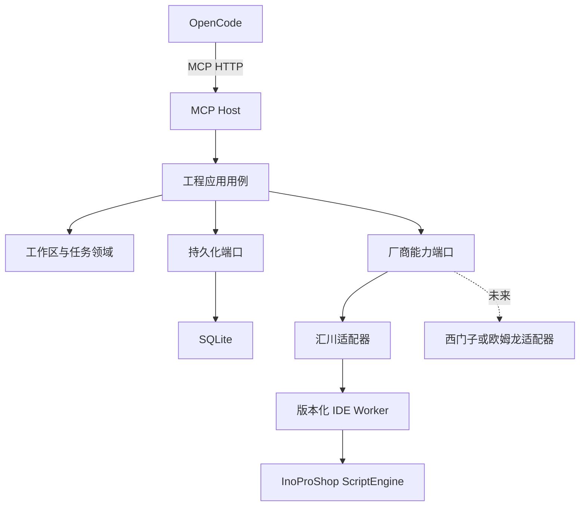
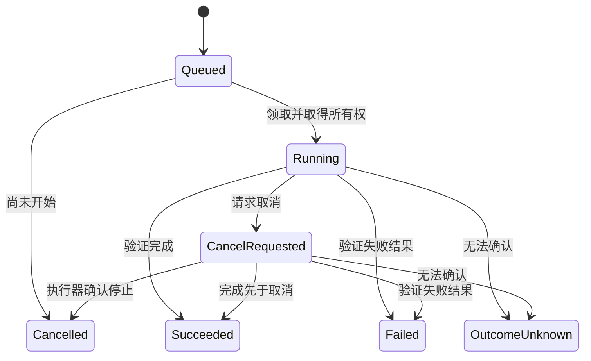

# 架构设计

## 总体设计

采用 DDD + Clean Architecture + Ports & Adapters 的模块化单体。Host、应用用例与平台元数据处于一个部署单元；IDE Worker 按运行时、版本和 Windows 会话进行进程隔离。

图表示目标执行结构。P0 仅落地 Host 能力发现、领域模型、能力契约与数据库映射；Worker 和可靠调度尚未实现。

## 模型与边界

| 领域/模块 | 权威内容 | 建模决定 |
|---|---|---|
| Workspace | 工作区身份、访问范围、工程路径、已确认修订 | `ProjectWorkspace` 聚合 |
| Automation | 操作身份、幂等请求、执行状态、结果确认 | `AutomationJob` 聚合 |
| Engineering | 工程对象快照、程序源、诊断和工程操作语义 | 应用端口与值/结果模型；不复制整个 IDE 对象体系 |
| IDE Integration | 厂商/版本映射、能力、会话和通信 | 适配器与基础设施；不为技术包装器制造业务聚合 |

工程管理和任务执行是目前明确的领域边界。工程对象与 IDE 集成保留模块边界，后续出现独立规则时再决定是否形成额外限界上下文。DDD 不要求每个模块三个 DLL 或每个持久化表一个 Repository。

`ProjectWorkspace.RecordVerifiedRevision` 校验旧修订并记录新修订；其自身不提供文件锁。外部文件状态、未保存 IDE 内存、规范化路径以及最终写入前的检查属于执行协议，不能靠一个哈希字段解决人工并发编辑。

## 依赖规则

- SharedKernel 不依赖项目其他层。
- Core 只引用 SharedKernel；不调用数据库、进程、MCP 或厂商 API。
- Contracts 定义应用端口与传输模型，可引用 Core，不引用外部实现。
- EngineeringService 只依赖 Contracts/Core，通过端口编排。
- Inovance 与 EntityFrameworkCore 实现外部能力，可引用内层，不能反向引用 Host。
- Host 是组合根，注册实现与 MCP 工具。Tool 负责协议转换，不承载工程编辑规则。
- 测试使用假执行器验证调度，但假结果不能作为真实 IDE 支持证据。

## 数据事实来源

| 内容 | 事实来源 |
|---|---|
| PLC 源程序、硬件、任务、库引用 | 厂商工程文件与当前受控 IDE 会话 |
| 工作区、执行任务、幂等登记、操作审计 | SQLite |
| 排队唤醒信号 | Channel；丢失后应从数据库重建 |
| 脚本能力 | 与实际 IDE/Profile/设备描述/库版本绑定的验证记录 |
| 编译结果 | 本次实际编译返回的结构化诊断和对应修订 |

SQLite 与工程文件不是一个原子事务。P2/P3 应实现：持久化意图 → 获取工程/IDE 所有权 → 核验修订 → 备份 → 执行 → 读回 → 保存/验证 → 记录结果。任何阶段崩溃，恢复逻辑先检查日志、工程和 Worker 状态，再决定结果。不能把数据库回滚解释为工程修改已回滚。

## 任务状态

`OutcomeUnknown` 不自动回到 Queued；后续需独立对账用例和证据。`Failed` 也不承诺工程未变更，结果中必须说明部分修改和备份状态。P0 实现状态迁移规则，租约、领取、恢复、审计和自动调度均待 P2。

## 进程与部署

Host 用 .NET 8 提供 MCP HTTP；汇川 Worker 由目标 Windows IDE 的真实脚本宿主执行。独立安装 IronPython 不能替代 InoProShop 提供的工程 API。首先验证登录用户会话，再评估无 UI 或 Windows 服务运行；不能假定 Session 0 可操作工程师桌面的 IDE。

未来 .NET Framework Worker 使用版本化 JSON 协议，不引用 `net8.0` Contracts DLL。西门子各版本所需运行时以其实际 SDK 为准，不统一假设全部要求 4.8。协议传 DTO 和稳定 ID，不传 CLR 类型名、厂商对象或 .NET 序列化二进制。

新增厂商主要新增适配器、能力声明与执行器；遇到新增业务语义仍可能演进契约，通过版本化保持已发布接口兼容，不承诺核心永远零修改。
